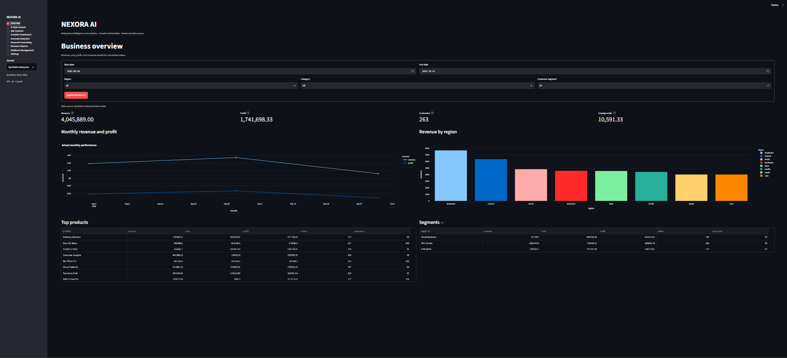
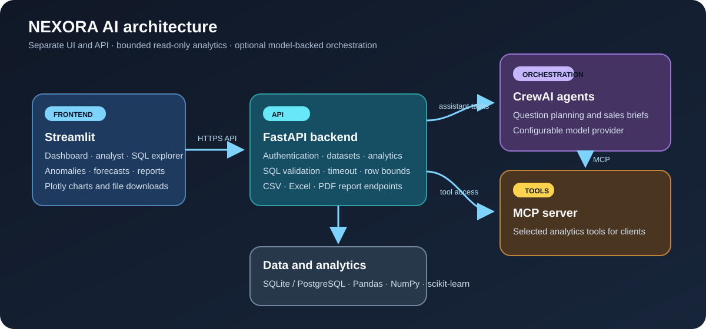

# NEXORA AI

**A local-first business intelligence demo built with FastAPI, Streamlit, CrewAI, and MCP.**

NEXORA turns business questions and sales data into reviewable SQL, analytics, forecasts, anomaly signals, and downloadable reports. It is a portfolio project using synthetic demo data; it is not a production-hardened service.

## Product preview

The overview brings filters, key metrics, trend charts, product performance, and customer segments into one dashboard.



## What it demonstrates

- **Business analytics:** filter revenue, profit, orders, customers, products, and segments by date and business dimensions.
- **Natural language to SQL:** ask a business question, inspect the generated query and returned rows, and use the SQL Explorer for a focused query view.
- **Guarded data access:** allow-listed tables, read-only queries, validation, execution timeouts, and bounded result sizes.
- **CrewAI and MCP:** a CrewAI sales-brief example that can use NEXORA analytics through its MCP server.
- **Applied analytics:** trailing-median anomaly signals and a linear revenue forecast with chronological holdout metrics.
- **Business reporting:** export filtered reports as CSV, Excel, or PDF.
- **Local-first setup:** run the FastAPI backend and Streamlit frontend locally, or use Docker Compose.

## Architecture



The Streamlit client calls the FastAPI service. Analytics and report endpoints share the same read-only data services. CrewAI can orchestrate supported assistant workflows, and MCP exposes selected analytics tools for other clients.

## Technology

| Area | Technology |
| --- | --- |
| Frontend | Streamlit, Plotly |
| API | FastAPI, Uvicorn, Pydantic |
| Orchestration | CrewAI; MCP server/client integration |
| Data and analytics | SQLAlchemy, SQLite or PostgreSQL, Pandas, NumPy, scikit-learn |
| Query safety | SQLGlot validation, table allow-list, read-only connections, time and row bounds |
| Reports | CSV, openpyxl, ReportLab |
| Packaging | Python, Docker Compose |

## Run locally

Use Python 3.11–3.13. In PowerShell, open the project folder and create the environment:

```powershell
py -V:3.12 -m venv .venv
.venv\Scripts\Activate.ps1
python -m pip install --upgrade pip
python -m pip install -e ".[mcp,dev]"
Copy-Item .env.example .env
python -m app.database.seed
```

For live LLM-backed CrewAI features, add your provider key to the private `.env` file. Never commit `.env`; it is ignored by Git. Without a provider key, supported demo questions can use the deterministic fallback, while the standalone CrewAI-to-MCP example requires a working model provider.

Start the API and UI in separate PowerShell terminals from the project folder.

**Terminal 1 — API**

```powershell
python -m uvicorn app.backend.main:app --reload --host 127.0.0.1 --port 8000
```

**Terminal 2 — Streamlit**

```powershell
python -m streamlit run app/frontend/ui.py --server.port 8501
```

Open `http://127.0.0.1:8501`. The API health endpoint is `http://127.0.0.1:8000/health`; interactive API documentation is at `http://127.0.0.1:8000/docs`.

If those ports are busy, use another free pair and point the frontend at the API. For example, with the API on `8765` and Streamlit on `8502`:

```powershell
# API terminal
python -m uvicorn app.backend.main:app --reload --host 127.0.0.1 --port 8765

# UI terminal
$env:NEXORA_API_URL = "http://127.0.0.1:8765"
python -m streamlit run app/frontend/ui.py --server.port 8502
```

## Docker Compose

```powershell
Copy-Item .env.example .env
docker compose -f docker-compose.nexora.yml up --build
```

Open `http://127.0.0.1:8501`. Compose binds the published ports to loopback and stores SQLite data in a named volume.

## Try the CrewAI + MCP example

With the API running, a model-provider key set in `.env`, and the `mcp` extra installed:

```powershell
python examples/crewai_sales_brief.py --start 2026-08-03 --end 2026-10-31 --region West
```

The example asks a CrewAI analyst to call NEXORA's `summarize_sales` MCP tool and write a short brief from its results. The bundled dataset is synthetic.

## Verify and evaluate

```powershell
python -m pytest -q
python scripts/evaluate_nl2sql.py
```

The current automated suite contains 15 tests. The 40-question SQL benchmark uses synthetic demo questions and reference results; anomaly metrics are measured against four seeded, labeled synthetic events. These checks describe this demo dataset and do not predict accuracy on real business data or arbitrary LLM-generated SQL.

## Security and scope

- The assistant is designed for bounded read-only `SELECT` queries over allow-listed schema objects.
- Store model keys and database credentials in environment variables or a local `.env` file that is never committed.
- Authentication and role checks are included for the demo, but deployment hardening, monitoring, secret rotation, and operational controls are outside this portfolio build.
- All bundled sales records are synthetic.

## Project guides

- [Technology and setup guide](docs/project-guide.md)
- [Architecture and phase acceptance criteria](docs/nexora-architecture.md)

## License

No license has been added. The repository is public to review; reuse permissions have not been granted through an open-source license.
